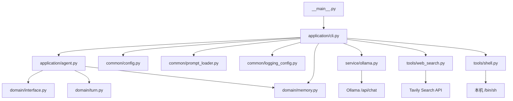
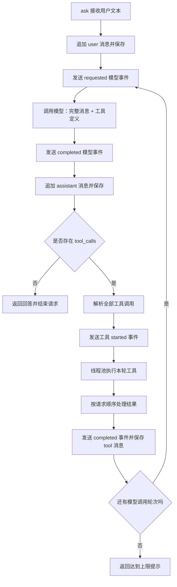

# Lin Agent 项目架构、工具注册与记忆机制详细总结

- 整理日期：2026-10-30（Asia/Tokyo）
- 项目目录：`/Users/zhanglin/Documents/project/lin-agent`
- 文档范围：总结本次对话中的项目结构、架构职责、工具注册、记忆实现、终端编码问题修复与接口文件重命名，并结合整理时的实际源码校正现状。
- 事实依据：本次聊天记录，以及 `src/`、`tests/`、`resource/prompt/system.md`、`pyproject.toml`、`run.sh` 的读取结果。
- 本次操作范围：新增总结文档，不修改业务代码，不覆盖已有的《记忆系统设计方案.md》。

## 一、阅读前提：区分对话中的早期版本和当前版本

这次讨论期间，项目代码发生了演进。因此，聊天中一些在当时成立的结论，已经不再代表整理时的代码状态。

| 主题 | 前面讲解时的版本 | 2026-10-30 核对到的当前实现 |
| --- | --- | --- |
| 接口文件名 | 最初为 `src/domain/ports.py` | 已按用户要求改为 `src/domain/interface.py` |
| 工具数量 | CLI 只注册网页搜索 | CLI 注册网页搜索和 Shell 两个工具 |
| 工具参数分发 | 固定读取 `query`，调用 `run(query)` | 使用 `run(**arguments)`，支持不同工具的参数 |
| 会话记忆 | `Agent.messages` 直接保存内存消息 | 独立 `Memory` 类管理消息，CLI 开启 JSON 持久化 |
| 重启后的历史 | 退出即丢失 | CLI 启动时可以从 `memory/history.json` 恢复 |
| `/reset` | 只清除进程内的历史 | 清除内存历史并保存空历史文件 |
| 能力边界 | 只有只读网页搜索 | Shell 可以在当前系统用户权限下执行命令 |
| 中文输入解码异常 | 未捕获，导致退出 | 已捕获 `UnicodeDecodeError` 并提示重新输入 |

本文保留早期结论用于说明讨论经过，但介绍当前架构时以实际源码为准。Shell 和持久化记忆是本次整理时发现的现有变更，不能据此推断它们由本聊天中的某一次操作实现。

## 二、本次对话的完整脉络

### 2.1 查看项目结构

用户首先要求了解项目结构。检查目录、README 和主要代码后，确定这是一个 Python 命令行个人 Agent，主要由应用层、领域层、模型服务适配、工具和通用模块组成。

最初的核心功能是：在终端输入问题，由 Ollama 中的模型判断是否需要搜索，调用 Tavily 后把搜索结果交给模型组织回答。

检查中还发现 `pyproject.toml` 的安装命令入口配置与实际模块路径不一致。该问题被指出，但本次对话没有执行对应修复。

### 2.2 排查终端中文输入导致的崩溃

用户运行程序，输入“朝鲜的首都最近发生了什么新闻”后，在 `input()` 处遇到 UTF-8 解码错误。修复是在 CLI 输入循环中捕获 `UnicodeDecodeError`，提示重新输入并继续循环。

这次修改解决的是异常造成进程退出的问题，没有证明或修复终端产生无效字节的根本原因。

### 2.3 解释项目架构

进一步介绍了 CLI 组装组件、Agent 调度模型与工具、领域接口隔离供应商实现、工具结果回传和事件回调机制。

同时说明：当前分层比较轻量，主要作用是拆分职责，而不是已经实现完整复杂的领域建模。

### 2.4 将 ports.py 重命名为 interface.py

用户明确要求把接口文件改名为 interface。实际修改为：

1. 将 `src/domain/ports.py` 移动为 `src/domain/interface.py`。
2. 将 `src/domain/__init__.py` 中的 `from .ports import ...` 改为 `from .interface import ...`。
3. 保留接口名称和当时的方法语义。
4. 运行测试确认导入和既有功能未受影响。

### 2.5 解释工具注册

说明了工具通过 CLI 构造函数参数手动注册，Agent 按名称保存实例，每轮向模型发送工具定义，再根据模型返回的名称和参数执行工具。

当时的执行器只接受搜索查询 `query`；当前代码已经改为通用关键字参数分发。

### 2.6 解释记忆功能

当时的回答说明记忆是内存中的消息列表，每次模型调用携带完整历史，程序退出后不会恢复。

当前代码已经引入独立 `Memory` 类和 JSON 历史文件，因此这部分必须分为“原理仍然成立”和“存储生命周期已经变化”：模型依然依赖请求中传入的上下文，但应用现在可以跨进程保存和恢复这些上下文。

## 三、项目定位与技术组成

### 3.1 项目解决什么问题

Lin Agent 提供一个终端中的个人助手入口。用户用自然语言提出目标，模型根据现有上下文和工具定义，决定直接回答或请求工具。

应用程序负责真正执行工具，并把结果送回模型。模型返回的工具调用只是结构化请求，本身不会自动执行 Python 函数或系统命令。

当前能力包括终端多轮对话、网页搜索、本机 Shell 执行、会话历史保存和恢复、过程展示及文件日志。

### 3.2 技术组成

| 项目 | 实际实现 |
| --- | --- |
| 开发语言 | Python，项目声明要求 3.10 及以上 |
| 交互入口 | 同步命令行循环 |
| 模型服务 | Ollama HTTP `/api/chat` |
| 默认模型名 | `gpt-oss:120b-cloud`，可配置 |
| 网页搜索 | Tavily Search API |
| 网络请求 | Python 标准库 `urllib.request` |
| HTTPS 证书 | `certifi` |
| 并发工具执行 | `ThreadPoolExecutor` |
| 历史持久化 | UTF-8 JSON 文件 |
| 日志 | Python 标准库 `logging` |
| 测试 | `unittest` 和 `unittest.mock` |
| 构建后端 | Hatchling |

“本机运行”指 Python 应用在本机运行，不代表模型推理和搜索均离线完成。实际推理位置取决于 Ollama 配置及所用模型，Tavily 搜索需要网络。

## 四、当前目录结构及职责

以下省略 `__init__.py`、Python 字节码缓存和虚拟环境内部文件；运行时路径不表示文件在每个环境中都已经存在。

```text
lin-agent/
├── src/
│   ├── __main__.py
│   ├── application/
│   │   ├── cli.py
│   │   └── agent.py
│   ├── domain/
│   │   ├── interface.py
│   │   ├── turn.py
│   │   └── memory.py
│   ├── service/
│   │   └── ollama.py
│   ├── tools/
│   │   ├── web_search.py
│   │   └── shell.py
│   └── common/
│       ├── config.py
│       ├── prompt_loader.py
│       └── logging_config.py
├── resource/
│   └── prompt/
│       └── system.md
├── tests/
│   ├── test_agent.py
│   ├── test_cli.py
│   ├── test_web_search.py
│   ├── test_memory.py
│   └── test_shell.py
├── 设计文档/
│   ├── 记忆系统设计方案.md
│   └── 本总结文档
├── memory/
│   └── history.json            # CLI 运行时保存历史的默认位置
├── data/
│   └── logs/
│       └── lin-agent.log       # 运行日志
├── pyproject.toml
├── run.sh
├── README.md
├── .env
├── .env.example
├── .gitignore
├── .git/
├── .idea/
└── venv/
```

`src/` 是业务源码，`resource/` 是非 Python 资源，`tests/` 是测试，`设计文档/` 用于保存设计和讨论记录。`.idea/` 是 IDE 配置，`venv/` 是本地运行环境，均不属于核心架构模块。

## 五、分层架构与依赖关系

### 5.1 总体关系



CLI 是组件组装位置，Agent 是用例调度核心，领域接口定义调用契约，具体适配器负责访问模型、网络和操作系统。

### 5.2 application：应用层

`cli.py` 面向终端用户，负责启动、命令处理、输出展示和已知异常提示；`agent.py` 面向一次对话用例，负责模型调用、工具执行和上下文更新。

把这两类职责拆开后，未来增加其他交互入口时，可以复用 Agent，而不必复用终端输入输出代码。

### 5.3 domain：接口、事件与记忆对象

`interface.py` 定义模型与工具的调用约定；`turn.py` 定义数据结构和事件；`memory.py` 管理消息与历史文件。

需要准确理解当前分层：`Memory` 直接包含 JSON 文件读写，因此领域目录并非严格意义上完全不依赖基础设施的纯领域层。当前实现优先选择了简单、直接的结构。

### 5.4 service 与 tools：外部适配

`service/ollama.py` 适配模型 API；`tools/` 中的搜索和 Shell 适配外部能力。从架构职责看，它们都在边界上处理外部交互。

目录名不同不代表二者具有完全不同的技术层级。模型客户端被 Agent 主动调用，工具则在模型提出调用请求后由 Agent 分发执行。

### 5.5 common：公共基础能力

配置加载、日志和提示词读取集中在 `common/`。Agent 仍直接使用公共日志模块，因此项目没有追求所有依赖都经过接口隔离。

## 六、程序启动与 CLI 生命周期

### 6.1 启动入口

执行 `python -m src` 时，Python 运行 `src/__main__.py`，由它导入并调用 `application.cli.main()`。

`run.sh` 会切换到脚本所在项目目录，优先选用 `venv/bin/python`，否则尝试 `python3.10`；确认能够导入 `certifi` 后执行 `python -m src`。

### 6.2 CLI 初始化顺序

1. 调用 `Settings.from_env()` 读取配置。
2. 调用 `configure_logging()` 初始化日志。
3. 调用 `load_system_prompt()` 读取系统提示词。
4. 创建 `Memory(system_prompt, DEFAULT_MEMORY_PATH)`，尝试恢复历史。
5. 创建 `OllamaClient`。
6. 创建 `WebSearchTool` 和 `ShellTool`。
7. 创建 `Agent`，注入模型、工具、记忆和事件回调。
8. 输出启动提示，进入终端输入循环。

如果历史文件无法解析或读取，CLI 捕获 `MemoryError`，显示错误并返回，不会直接忽略损坏的历史继续启动。

### 6.3 交互命令

| 输入 | 行为 |
| --- | --- |
| 普通文本 | 调用 `agent.ask(text)` |
| 空白输入 | 跳过本轮 |
| `/help` | 显示可用命令 |
| `/reset` | 清除当前消息和已保存的历史 |
| `/exit` | 退出程序 |
| EOF 或 Ctrl+C | 显示结束提示并退出 |
| 无效 UTF-8 输入 | 提示编码错误，重新等待输入 |

## 七、Agent 核心循环详解

### 7.1 组件与状态

Agent 保存模型客户端、按名称索引的工具实例、系统提示词、记忆对象以及两个可选事件回调。

当前 `messages` 是属性，返回 `self.memory.messages`。这意味着读取 `agent.messages` 仍能获得消息列表，但消息的正常追加和重置已交由 `Memory` 完成。

### 7.2 一次请求的执行过程



### 7.3 8 轮限制的准确含义

代码字段叫 `max_tool_rounds`，但循环体每次都会调用一次模型。因此，严格来说限制的是每次 `ask()` 中最多 8 次模型请求，并非最多执行 8 个工具。

每轮可以包含多个工具调用，总工具次数可以超过 8。第 8 轮如果仍返回工具请求，程序会执行这些工具，但不会再进行第 9 次模型调用来总结结果，而是返回上限提示。

这个上限提示直接作为 `ask()` 返回值交给 CLI，当前实现没有把它作为新的 assistant 消息追加到记忆。

### 7.4 工具并发与顺序

Agent 使用 `ThreadPoolExecutor(max_workers=len(tool_calls))` 执行同轮调用。`executor.map` 保留输入顺序，因此实际完成时间可以不同，但写入消息历史的结果顺序仍与请求顺序一致。

当前代码对同轮全部工具统一并行，没有程序级的只读/写入区分，也没有依赖分析。系统提示词要求模型把独立只读操作并行、把依赖操作分轮，但这一要求属于模型行为约束。

### 7.5 没有工具请求意味着本轮结束

只要模型响应没有 `tool_calls`，Agent 就把 `content` 返回给用户。程序没有额外的目标完成判定器；是否继续核实、是否需要进一步搜索，主要由模型和提示词决定。

因此，“自动检查是否满足目标”描述的是模型在循环中的职责，不应理解为代码已经实现了独立、可靠的业务结果验证系统。

## 八、interface.py：模型与工具的接口契约

### 8.1 为什么定义接口

接口让调度器围绕统一的方法签名编程，避免在核心流程中写满供应商判断。

模型服务约定：

```python
class ModelGateway(Protocol):
    def chat(self, messages, tools) -> dict:
        ...
```

当前工具约定：

```python
class AgentTool(Protocol):
    name: str
    definition: dict

    def run(self, **arguments) -> dict:
        ...
```

`Protocol` 主要用于表达结构化类型约定。实现类不必显式继承该接口；当前代码也没有在运行时自动校验每个实例是否完全符合协议。

### 8.2 改名的影响

重命名只调整模块路径。`ModelGateway`、`AgentTool` 这些对外名称保持不变，其他文件如果从 `domain` 包导入它们，不需要逐个修改。

`domain/__init__.py` 通过 `from .interface import AgentTool, ModelGateway` 重新导出接口，起到了统一导入入口的作用。

### 8.3 数据抽象的实际边界

虽然有接口和 `AgentTurn`、`ToolRequest` 数据类，主流程仍直接使用模型供应商风格的消息字典，例如 `response['message']`、`message['tool_calls']`。

所以替换模型客户端时，除了满足 `chat()` 签名，还需要返回 Agent 当前能理解的字典结构，或者在客户端中完成格式转换。

## 九、工具注册与调用机制

### 9.1 注册发生在本地应用中

当前 CLI 使用：

```python
tools=[
    WebSearchTool(settings.tavily_api_key, settings.search_result_limit),
    ShellTool(),
]
```

Agent 接收后执行：

```python
self.tools = {tool.name: tool for tool in tools}
```

形成类似下面的映射：

```text
web_search → WebSearchTool 实例
shell      → ShellTool 实例
```

这是一种手动、显式注册机制。把 Python 文件放到 `tools/` 目录不会自动启用工具；还需要导入类、创建实例并加入 CLI 的列表。

如果两个工具使用同一个 `name`，字典推导式会保留后一个实例，当前没有重名校验。

### 9.2 工具定义让模型知道如何调用

`definition` 包含工具名称、用途说明和参数的 JSON Schema。Agent 每次调用模型，都提取所有工具的定义发送过去。

发送给模型的是说明信息，不是 Python 实例、实现代码或 Tavily 密钥。工具执行依然发生在应用进程中。

例如搜索工具的关键参数是 `query`，Shell 的关键参数是 `command`，并支持 `cwd`、`timeout`。

### 9.3 从模型响应到函数执行

模型可能返回：

```json
{
  "function": {
    "name": "web_search",
    "arguments": {"query": "平壤 最近 新闻"}
  }
}
```

Agent 提取名称与参数，检查名称是否存在于注册表，再调用：

```python
self.tools[tool_name].run(**arguments)
```

对应搜索工具就是 `run(query="平壤 最近 新闻")`，对应 Shell 可以是 `run(command="pwd", cwd="某目录", timeout=30)`。

如果 arguments 是字符串，Agent 尝试使用 `json.loads()` 解析；解析失败或不是字典时，将参数替换为空字典。工具参数不匹配等异常由 `_execute_tool()` 捕获并转为错误结果。

代码没有实现一个通用的 JSON Schema 校验器。Schema 用于告知模型参数形状，具体检查仍依靠工具实现和 Python 调用约束。

### 9.4 工具结果回传

结果被封装成 role 为 `tool` 的消息，content 是 JSON 字符串：

```json
{
  "tool": "web_search",
  "arguments": {"query": "平壤 最近 新闻"},
  "result": {"results": []}
}
```

模型下一轮会看到这段结果，从而决定回答、换搜索词或继续调用其他工具。工具结果报错也会成为上下文，让模型有机会调整策略。

### 9.5 新增工具的实际步骤

1. 在合适模块实现工具类。
2. 定义唯一的 `name`。
3. 编写 `definition`，明确用途和参数。
4. 实现 `run()`，返回可 JSON 序列化的数据。
5. 根据工具用途处理参数和执行失败。
6. 在需要时从 `tools/__init__.py` 导出。
7. 在 CLI 中导入、实例化并加入工具列表。
8. 验证模型返回的参数能被执行，并且结果能回传。

当前已支持关键字参数分发，新增非搜索工具通常不再需要改动 Agent 的参数提取逻辑。

## 十、当前两个工具的实现

### 10.1 WebSearchTool

搜索工具调用 Tavily 的 `https://api.tavily.com/search`。

主要行为：检查搜索词和 API Key；使用 basic 搜索深度；按配置限制结果数量；不请求 Tavily 直接生成答案；使用 `certifi` 证书创建 HTTPS 校验上下文；网络请求超时为 20 秒。

返回结果统一为标题 `title`、来源 `url` 和摘要 `snippet`，供模型组织答案。搜索摘要不等于网页全文，当前工具没有内置网页正文抓取和浏览器操作。

### 10.2 ShellTool

Shell 工具通过 `subprocess.Popen` 和 `/bin/sh` 执行本机命令，参数包括：

| 参数 | 含义 |
| --- | --- |
| `command` | 必填，非空命令字符串 |
| `cwd` | 可选工作目录，不传则使用 Agent 进程当前目录 |
| `timeout` | 默认 30 秒，合法范围为整数 1–300 |

标准输入连接到 `DEVNULL`，因此不支持正常的交互输入。每次调用都会创建独立命令进程，前一次命令中的 `cd` 或局部 Shell 变量不会自动保留到下一次。

输出先写入临时文件，返回时每个输出流最多读取 16000 字节，并提供截断标志。UTF-8 解码失败时会替换无效字节。超时后会尝试杀死该进程组并等待进程结束。

返回字段包括 `cwd`、`exit_code`、`timed_out`、`stdout`、`stderr`、`stdout_truncated`、`stderr_truncated`。

当前没有单独的沙箱、命令白名单或逐次确认执行器。Shell 的权限来自启动 Agent 的系统用户，授权要求主要体现在系统提示词中。不能继续沿用早期“项目只有只读搜索能力”的描述。

## 十一、记忆机制：原理与当前持久化实现

### 11.1 记忆的基础仍是消息历史

模型能够接着回答“第二条新闻展开讲讲”，是因为应用在下一轮请求中再次发送了之前的用户问题、搜索结果和模型回答。

典型历史如下：

```text
system     当前系统提示词
user       平壤最近有什么新闻？
assistant  请求 web_search
 tool      搜索结果（实际 role 为 tool）
assistant  新闻概述
user       第二条展开讲讲
assistant  根据前面的内容继续回答
```

这不会修改模型权重，也不等于模型在服务端建立了一个永久用户知识库。

### 11.2 早期实现

早期 Agent 直接持有 `self.messages`。`reset()` 将列表恢复为仅包含 system 消息；`ask()` 不断追加 user、assistant 和 tool 消息。

这种实现只存在于当前进程内，退出即丢失。前面聊天中的记忆讲解对应这一版本。

### 11.3 当前 Memory 类

`src/domain/memory.py` 引入：

```python
Memory(system_prompt, path=None)
```

- 不传 path：纯内存模式。
- 传入 path：启用文件保存和启动恢复。

Agent 未显式接收 memory 时，默认创建 `Memory(system_prompt)`，因此单独使用 Agent 仍可能只有内存记忆。

CLI 显式创建 `Memory(system_prompt, DEFAULT_MEMORY_PATH)`，默认路径由源码位置推导到项目根目录下的 `memory/history.json`，所以正常 CLI 使用已具备跨重启恢复能力。

### 11.4 启动恢复

Memory 先创建当前 system 消息。如果历史文件存在，则读取 UTF-8 JSON，要求顶层为列表，元素为字典，且 role 只能是 user、assistant 或 tool。

校验通过后，把历史追加到当前 system 消息后面。当前校验是基础形状校验，没有全面检查每个角色的 content、工具配对和消息语义完整性。

如果文件损坏、结构不合法或读取失败，抛出项目自定义的 `MemoryError`。现有测试确认损坏文件不会因此被覆盖。

### 11.5 保存时机和方式

每次 `Memory.append()` 都先追加内存消息，再调用 `_save()`。因此用户消息、模型响应和每条工具结果都会触发一次保存。

保存时只写 `self.messages[1:]`，排除 system 消息。使用 UTF-8、`ensure_ascii=False` 和缩进格式，中文可直接阅读。

程序先在目标目录创建临时文件，写完后用 `os.replace()` 替换目标文件，并清理残留临时路径。这样可以减少读者看到半个 JSON 文件的情况，但不代表具有数据库事务、跨进程锁或完整的断电持久性保证。

### 11.6 系统提示词与历史分开

不把 system 消息写入历史文件，可以让每次启动重新加载最新提示词，并注入启动时的日期。

当前提示词在启动时加载一次。程序跨越午夜持续运行时，不会自动每天替换日期；`/reset` 也使用现有 Memory 对象保存的 system_prompt。

### 11.7 reset 的实际行为

`Memory.reset()` 用切片赋值把现有列表变成仅有 system 消息，然后保存。

磁盘历史会被写成空列表 `[]`，而不是删除文件。下次启动读取空列表后仍只有新加载的 system 提示词。

### 11.8 当前限制

- 完整历史持续增长，没有按 token 或消息数截断。
- 没有自动摘要、重要事实提取、向量检索或语义记忆召回。
- 默认只有一个历史文件，没有会话 ID 和会话列表。
- 没有跨进程文件锁，多个进程同时使用同一路径可能覆盖彼此的历史。
- 每次追加都重新写完整历史，大历史下会增加写入开销。
- 保存失败时，内存已经改变，当前没有回滚内存状态。
- 进程中断可能留下只有用户提问、或工具调用未配对完成的中间历史。
- 历史以明文保存，可能包含对话内容和工具输出。
- 恢复的旧搜索结果仍然是旧数据，不会因被保存而自动变成最新事实。

所以准确说法是：当前已实现“会话历史持久化”，尚未实现独立的“长期知识记忆系统”。

## 十二、终端 UTF-8 异常修复记录

### 12.1 故障位置

用户输入中文后，异常发生在：

```python
text = input("\n你：").strip()
```

关键错误为 `UnicodeDecodeError: 'utf-8' codec can't decode ... invalid continuation byte`。

这说明输入读取阶段收到的字节不能按 UTF-8 正常解码。异常发生在 `agent.ask()` 之前，因此不能把该次错误归因于模型或 Tavily 搜索。

仅靠堆栈无法确定字节来源：终端编码、输入链路或其他输入异常都需要进一步复现才能判断。

### 12.2 修复内容

在输入循环中增加：

```python
except UnicodeDecodeError:
    print("\n输入解码失败：终端收到的内容不是有效的 UTF-8。请切换终端编码为 UTF-8 后重新输入。")
    continue
```

这会丢弃本次无法正常解码的输入并重新等待，不向模型传递乱码，不重建 Agent，也不清除历史。

### 12.3 验证内容与边界

新增 `tests/test_cli.py`，模拟一次解码异常、一次正常中文提问和 `/exit`，检查 Agent 只初始化一次、正常问题只提交一次、错误提示与正常回答均出现。

修复当时运行 `venv/bin/python -m unittest discover -s tests`，结果为 7 项测试通过。接口文件重命名后也运行过同一测试命令，结果同样为 7 项通过。

这两个数字是当时的历史验证结果。当前仓库已新增记忆和 Shell 测试，不能将“当时 7 项通过”写成“当前整个版本已全部验证”。本次文档整理未重新执行测试或发起模型、搜索请求。

## 十三、事件回调、日志和异常处理

### 13.1 回调展示执行过程

Agent 支持 `on_model_event` 和 `on_tool_event`。

模型事件包括 requested、completed，携带轮次、消息和响应；工具事件包括 started、completed，携带工具名称、参数与结果。

当前 CLI 会把模型请求消息、模型返回和工具结果以 JSON 形式输出到终端。这比早期 README 中的“仅显示摘要”更详细，应以代码为准。

### 13.2 文件日志与会话历史不同

日志默认写入 `data/logs/lin-agent.log`，记录启动、模型请求、调用轮次、搜索数量和异常等运行信息。

`memory/history.json` 才是会话恢复来源。日志、终端展示和历史文件是三条不同的数据路径，不能因为日志设计上不主动记录完整对话，就推断终端和记忆文件也不含完整内容。

### 13.3 已有错误处理

| 场景 | 当前处理 |
| --- | --- |
| 无效终端 UTF-8 | CLI 提示并继续输入 |
| EOF / Ctrl+C | 正常结束 |
| 未注册工具名 | Agent 抛出 `AgentStateError`，CLI 提示 |
| 工具 run 执行抛异常 | 包装为工具错误结果交回模型 |
| 搜索词为空或缺少密钥 | 搜索工具返回错误字典 |
| Ollama 连接失败 | 转换为 `OllamaError` |
| Ollama JSON 解析失败 | 转换为 `OllamaError` |
| 历史文件读写异常 | 转换为项目的 `MemoryError` |
| 达到轮次上限 | 返回文字提示 |

这里是现有覆盖范围，不意味着全部初始化、配置或网络异常都被统一处理。

## 十四、配置与提示词

### 14.1 配置项

| 环境变量 | 默认值 | 用途 |
| --- | --- | --- |
| `OLLAMA_HOST` | `http://127.0.0.1:11434` | Ollama 地址 |
| `OLLAMA_MODEL` | `gpt-oss:120b-cloud` | 模型名称 |
| `TAVILY_API_KEY` | 无 | Tavily 搜索密钥 |
| `SEARCH_RESULT_LIMIT` | `5` | 搜索结果数量 |
| `LOG_LEVEL` | `INFO` | 日志级别 |

`.env` 使用简易加载器读取，已有环境变量优先。默认从进程当前工作目录读取 `.env`；`run.sh` 切到项目根目录后启动，可使该路径保持一致。本文没有读取或记录 `.env` 中的实际密钥。

### 14.2 系统提示词

提示词路径为 `resource/prompt/system.md`，加载器替换 `{{CURRENT_DATE}}`。当前提示词包含任务协作、工具循环、网页核验、Shell 使用、文件修改、记忆可信边界和回答方式等要求。

提示词用于指导模型决策；程序中的工具注册、参数校验、执行权限和存储机制仍由代码决定。提示词不等同于操作系统权限隔离。

## 十五、测试结构与本次核对边界

| 文件 | 主要关注点 |
| --- | --- |
| `tests/test_agent.py` | 自动工具循环、事件通知、同轮并发与结果顺序 |
| `tests/test_cli.py` | 解码异常后继续输入并正确提交正常问题 |
| `tests/test_web_search.py` | 缺少 API Key 和搜索结果字段映射 |
| `tests/test_memory.py` | 恢复历史、当前提示词替换、重置持久化、损坏文件保护 |
| `tests/test_shell.py` | stdout/stderr、退出码、目录、超时、参数、截断和 Agent 参数分发 |

本次整理通过读取源码核对架构，没有启动真实 Agent，也没有修改历史文件或调用外部服务。

后续若运行当前 CLI 测试，应注意它没有显式模拟 Memory，CLI 初始化会读取默认历史路径；隔离测试环境或模拟记忆对象有助于避免依赖个人运行数据。这是从代码得到的测试隔离观察，不是本次新增的修复。

## 十六、已发现但未在本次处理的问题

### 16.1 安装命令入口仍不一致

`pyproject.toml` 当前配置：

```toml
[project.scripts]
lin-agent = "src.cli:main"
```

实际 CLI 模块是 `src.application.cli`。因此安装后执行 `lin-agent` 可能因找不到 `src.cli` 而失败。

建议修改目标为 `src.application.cli:main`，但本次只整理文档，没有修改这一配置。`python -m src` 和 `./run.sh` 使用的入口不依赖这个配置。

### 16.2 早期说明与现状需要持续同步

“只有搜索”“退出后历史丢失”“工具固定 query 参数”“终端仅显示摘要”等表述对应旧版本。维护说明时应核对 CLI 注册列表、Memory 注入方式和实际输出函数。

### 16.3 扩展方向尚未自动实现

消息预算与摘要、多会话管理、工具重名检测、通用参数校验、工具执行权限控制、写操作串行策略、更完整的模型响应格式校验都属于可继续设计的方向。

这些是基于当前代码的后续考虑，不是已经批准实施的任务，也不表示项目现有实现已经包含这些能力。

## 十七、关键概念对照

| 概念 | 在本项目中的具体含义 |
| --- | --- |
| CLI | 终端交互和组件组装入口 |
| Agent | 维护对话并调度模型与工具的应用对象 |
| 模型客户端 | 把统一输入转换为 Ollama HTTP 请求 |
| 接口 | `Protocol` 表达的调用契约 |
| 工具注册 | 将实例传给 Agent 并按名称建立字典 |
| 工具定义 | 告诉模型工具用途和参数的结构化说明 |
| 工具调用 | 模型提出的名称与参数请求 |
| 工具执行 | 本地 Python 程序调用工具实例 |
| 工具结果 | 回传给模型并保存到历史的执行数据 |
| 短期上下文 | 本次模型请求携带的消息历史 |
| 历史持久化 | 将消息保存到 JSON 并在下次启动恢复 |
| 长期知识记忆 | 尚未实现的事实提取、摘要或检索体系 |
| 日志 | 用于排查运行过程的记录，不负责会话恢复 |
| 系统提示词 | 每次启动加载的模型行为说明 |

## 十八、源码阅读顺序

建议先看 `src/__main__.py` 和 `src/application/cli.py`，理解启动和组装；再看 `src/application/agent.py`，掌握循环；随后看 `src/domain/interface.py`、`src/domain/turn.py` 与 `src/domain/memory.py`，理解契约、事件和状态；最后阅读 Ollama、搜索和 Shell 的实现以及对应测试。

阅读时围绕四个问题追踪即可：用户输入在哪里进入，模型请求携带什么，工具由谁执行，执行后的消息在哪里保存。它们对应 CLI、Agent/模型客户端、工具注册表和 Memory，构成当前项目的核心运行链路。
